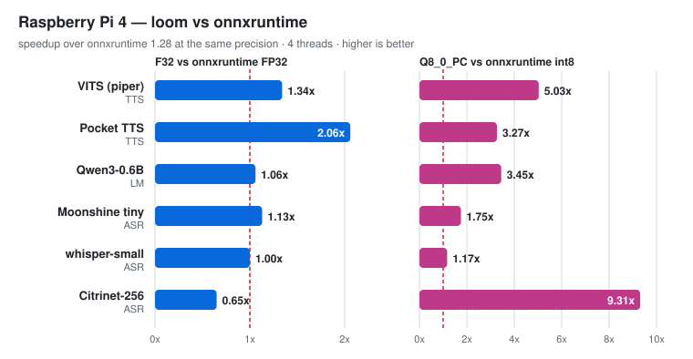
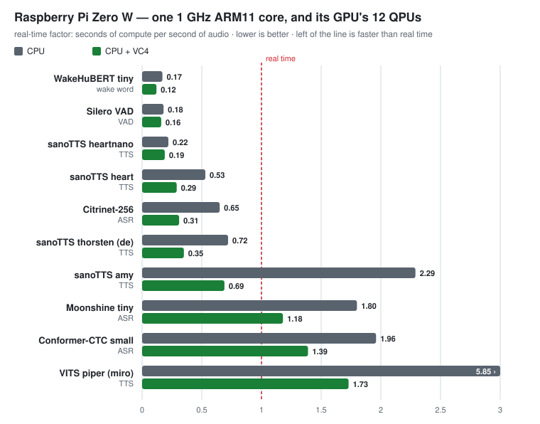
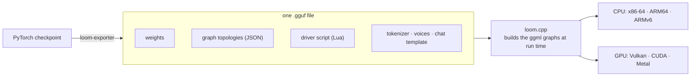

<h1 align="center">
  <picture>
    <source media="(prefers-color-scheme: dark)" srcset="assets/logo-inline-dark.svg">
    
  </picture>
  &nbsp;loom.cpp
</h1>

<p align="center">
  <b>Speech, audio and language models on everything from a GPU to a Raspberry Pi Zero.</b><br>
  One self-describing GGUF per model · no per-model code · built on <a href="https://github.com/ggml-org/ggml">ggml</a>
</p>

<p align="center">
  <a href="https://pypi.org/project/loom-py-rt/"></a>
  <a href="https://huggingface.co/loom-ai-org"></a>
  <a href="LICENSE"></a>
  
</p>

---

loom.cpp is a small inference engine for **speech recognition, text to speech, voice activity, speaker
and language identification, audio codecs, music and small language models**. Every model is a single
GGUF file that carries its weights, its compute graphs and the script that drives them, so the engine
runs **64 models** across speech, audio and text without a line of model-specific C++. Export a new
checkpoint and it runs everywhere loom does.

## Highlights

* 🚀 **Faster than onnxruntime on a Raspberry Pi 4.** loom's int8 beats onnxruntime's int8 on every
  model measured, by **1.2x to 9.3x**. At F32 it is ahead on four of six models, level on whisper and
  behind on Citrinet ([charts below](#performance)).
* 🍓 **Real time on a Raspberry Pi Zero.** Wake-word features, voice activity, tiny TTS voices and
  Citrinet ASR all run faster than real time on the Zero W's single 1 GHz ARM11 core with 512 MB of RAM.
* 📦 **One file per model.** Weights, graph topologies, driver script, tokenizer and voices travel
  together. Nothing to configure, and no Python needed at run time.
* 🧩 **64 models, one engine.** Whisper, Parakeet, Canary, Moonshine, Kokoro, Piper VITS, Pocket TTS,
  CosyVoice3, Qwen3-TTS, Voxtral TTS, MusicGen, Qwen3, Gemma 3 and more ([catalogue](#supported-models)).
* ⚡ **CPU everywhere, GPU where you have one.** x86-64, ARM64, 32-bit ARMv6 and Apple Silicon on the
  CPU; Vulkan, CUDA and Metal as optional backends.
* 🔢 **Per-channel int8 (`Q8_0_PC`)** with hand-tuned kernels for the Pi 4's Cortex-A72 and the Pi
  Zero's ARM11, beside ggml's own F32, F16 and Q4/Q8 formats.

## Quickstart

### Python

```sh
pip install "loom-py-rt[hub]"
```

```python
import loom

# Text to speech: Kyutai's Pocket TTS, 130 MB at int8, with 26 voices
tts = loom.Model.from_pretrained("loom-ai-org/pocket-tts-loom", "pocket-tts-q8_0_pc.gguf")
tts.text2speech.infer("Hello from a Raspberry Pi!").save("hello.wav")

# Speech recognition: Whisper, with timestamps (16 kHz mono audio)
import soundfile
audio, _ = soundfile.read("speech.wav")
asr = loom.Model.from_pretrained("loom-ai-org/whisper-small-loom")
print(asr.speech2text.infer(audio, language="en").text)
# ' And so my fellow Americans, ask not what your country can do for you, ...'

# A small chat model
lm = loom.Model.from_pretrained("loom-ai-org/gemma-3-270m-it-loom")
print(lm.text2text.chat("What is the capital of France?", temperature=0.0))
# 'The capital of France is Paris.'
```

Every model answers through the door named for what it does (`speech2text`, `text2speech`,
`text2text`, `speech2class`, `speech2embeddings`, `text2class`, `text2codes`, `codes2speech`). The
[loom-py README](https://github.com/loom-ai-org/loom-py) has an example for each.

### Command line (C++)

```sh
git clone https://github.com/loom-ai-org/loom.cpp && cd loom.cpp
cmake -B build -DCMAKE_BUILD_TYPE=Release && cmake --build build -j"$(nproc)"

loom_cli=build/tools/loom_cli/loom_cli
$loom_cli --model whisper-small.gguf --wav samples/jfk.wav                       # transcribe
$loom_cli --model pocket-tts-q8_0_pc.gguf --prompt "Hello from loom." --out hi.wav # speak
$loom_cli --model gemma-3-270m-it.gguf --chat --prompt "Tell me a joke."          # chat
```

CMake fetches every dependency (ggml, LuaJIT, nlohmann_json). Building for a GPU, for 32-bit ARM, and
running the tests are covered in [`docs/BUILDING.md`](docs/BUILDING.md).

## Performance

Both engines were run on the same board, at the same precision, with the same thread count, inputs and
output length. **A bar past the dashed line means loom is faster**:

<picture>
  <source media="(prefers-color-scheme: dark)" srcset="assets/charts/pi4-vs-onnxruntime-dark.svg">
  
</picture>

| Raspberry Pi 4, 4 threads | loom F32 | onnxruntime FP32 | loom int8 | onnxruntime int8 |
|---|---|---|---|---|
| VITS Piper en-GB · TTS, 3.3 s of speech | **0.80 s** | 1.07 s | **0.82 s** | 4.12 s |
| Pocket TTS · TTS, 4.8 s of speech¹ | **9.11 s** | 18.77 s | **4.25 s** | 13.88 s |
| Qwen3-0.6B · 24 tokens | **16.6 s** | 17.6 s | **4.15 s** | 14.28 s |
| Moonshine tiny · ASR, 11 s clip | **1.34 s** | 1.50 s | **0.85 s** | 1.49 s |
| whisper-small · ASR, 11 s clip | 20.7 s | 20.6 s | **12.5 s** | 14.7 s |
| Citrinet-256 · ASR, 11 s clip | 0.45 s | **0.29 s**² | **0.46 s** | 4.30 s² |

The tiny models run below real time even on a Pi Zero:

<picture>
  <source media="(prefers-color-scheme: dark)" srcset="assets/charts/pi-zero-rtf-dark.svg">
  
</picture>

Distilled Pocket TTS on a Pi 4 synthesises 4.8 s of speech in **0.59 s (2M)**, **1.07 s (7M)** and
**1.44 s (18M)** at int8. Every number above, with its protocol, the onnxruntime build, the GGUF
checksums and the x86 measurements, is in [`docs/BENCHMARKS.md`](docs/BENCHMARKS.md).

<sub>onnxruntime 1.28.0 (PyPI wheel). Times are paired medians of five launches, with the board cooled to 60 °C
before each one. Both engines did the same work: the same samples, transcripts and tokens.
¹ Against the community ONNX export [`KevinAHM/pocket-tts-onnx`](https://huggingface.co/KevinAHM/pocket-tts-onnx),
since there is no official one. ² onnxruntime is timed from precomputed mel features; loom's time includes
its front end.</sub>

## Supported models

All on [huggingface.co/loom-ai-org](https://huggingface.co/loom-ai-org), ready for
`loom.Model.from_pretrained(...)`. Sizes are the GGUF on disk, with the int8 file first where both are
published. Each model keeps its upstream licence: † marks a non-commercial one, and each model card
has the details.

### 🎙️ Speech recognition

| Model | Size | Languages | |
|---|---|---|---|
| [Whisper small](https://huggingface.co/loom-ai-org/whisper-small-loom) | 969 MB | 99 | transcribe and translate, timestamps |
| [Canary 1B v2](https://huggingface.co/loom-ai-org/canary-1b-v2-loom) | 3.9 GB | 25 | transcribe and translate, long-form |
| [Parakeet-TDT 0.6B v3](https://huggingface.co/loom-ai-org/parakeet-tdt-0.6b-loom) | 2.5 GB | 25 | |
| [Parakeet-RNNT 0.6B](https://huggingface.co/loom-ai-org/parakeet-rnnt-0.6b-loom) | 2.5 GB | en | |
| [Nemotron 3.5 ASR Streaming 0.6B](https://huggingface.co/loom-ai-org/nemotron-3.5-asr-streaming-0.6b-loom) | 2.6 GB | 35 | streaming, language prompt |
| [Qwen3-ASR 0.6B](https://huggingface.co/loom-ai-org/qwen3-asr-0.6b-loom) | 3.1 GB | 30 | |
| [Granite Speech 4.0 1B](https://huggingface.co/loom-ai-org/granite-speech-4.0-1b-loom) | 8.8 GB | 6 | transcribe and translate |
| [Kyutai STT 1B](https://huggingface.co/loom-ai-org/kyutai-stt-1b-en-fr-loom) | 4.2 GB | en, fr | streaming |
| [LFM2.5-Audio 1.5B](https://huggingface.co/loom-ai-org/lfm2.5-audio-1.5b-asr-loom) | 5.2 GB | en | |
| [SenseVoice Small](https://huggingface.co/loom-ai-org/sensevoice-small-loom) | 939 MB | zh, en, ja, ko, yue | |
| [Paraformer-large](https://huggingface.co/loom-ai-org/paraformer-zh-loom) | 866 MB | zh, en | non-autoregressive |
| [GigaAM v3 RNNT](https://huggingface.co/loom-ai-org/gigaam-v3-rnnt-loom) | 893 MB | ru, en | |
| [Moonshine tiny](https://huggingface.co/loom-ai-org/moonshine-tiny-loom) | 31 / 110 MB | en | fast on a Pi |
| [Moonshine Streaming tiny](https://huggingface.co/loom-ai-org/moonshine-streaming-tiny-loom) · [small](https://huggingface.co/loom-ai-org/moonshine-streaming-small-loom) | 136 / 495 MB | en | streaming |
| [Conformer-CTC small](https://huggingface.co/loom-ai-org/conformer-ctc-small-loom) | 60 MB | en | |
| [Citrinet-256](https://huggingface.co/loom-ai-org/citrinet-256-ls-loom) · [Citrinet-1024](https://huggingface.co/loom-ai-org/citrinet-1024-loom) | 13 MB · 565 MB | en | real time on a Pi Zero (256) |
| [HuBERT Large](https://huggingface.co/loom-ai-org/hubert-large-ls960-ft-loom) · [data2vec-audio Base](https://huggingface.co/loom-ai-org/data2vec-audio-base-960h-loom) | 1.3 GB · 373 MB | en | |

### 🗣️ Text to speech

| Model | Size | Languages | |
|---|---|---|---|
| [Pocket TTS](https://huggingface.co/loom-ai-org/pocket-tts-loom) | 130 / 405 MB | en | 26 voices, takes text |
| Pocket TTS distilled [18M](https://huggingface.co/loom-ai-org/pocket-tts-18m-loom) · [7M](https://huggingface.co/loom-ai-org/pocket-tts-7m-loom) · [2M](https://huggingface.co/loom-ai-org/pocket-tts-2m-loom) | 31 · 11 · 4.2 MB | en | new in 1.0.0-rc19 |
| [Kokoro 82M](https://huggingface.co/loom-ai-org/kokoro-82m-loom) | 325 MB | en | |
| [Piper VITS en-GB miro](https://huggingface.co/loom-ai-org/vits-piper-en-gb-miro-loom) | 63 MB | en-GB | |
| [sanoTTS](https://huggingface.co/loom-ai-org/sanotts-loom) | 1–9 MB | 14 | 28 tiny voices (GPL-3.0) |
| [Vocetta2 1M](https://huggingface.co/loom-ai-org/vocetta2-1m-loom) · [500K](https://huggingface.co/loom-ai-org/vocetta2-500k-loom) · [276K](https://huggingface.co/loom-ai-org/vocetta2-276k-loom) | 2.9 · 1.2 · 0.6 MB | en | a whole TTS in under 3 MB |
| [Supertonic 2](https://huggingface.co/loom-ai-org/supertonic-2-loom) | 268 MB | 5 | takes text |
| [Soprano 1.1 80M](https://huggingface.co/loom-ai-org/soprano-1.1-80m-loom) | 441 MB | en | 32 kHz |
| [SpeechT5](https://huggingface.co/loom-ai-org/speecht5-tts-loom) | 636 MB | en | voice files |
| [Matcha-TTS](https://huggingface.co/loom-ai-org/matcha-tts-ljspeech-loom) · [StyleTTS2](https://huggingface.co/loom-ai-org/styletts2-ljspeech-loom) | 129 · 411 MB | en | LJSpeech |
| [Chatterbox](https://huggingface.co/loom-ai-org/chatterbox-loom) | 2.7 GB | en | |
| [Fun-CosyVoice3 0.5B](https://huggingface.co/loom-ai-org/fun-cosyvoice3-0.5b-loom) | 3.4 GB | 9 | voice cloning |
| [Qwen3-TTS 0.6B](https://huggingface.co/loom-ai-org/qwen3-tts-12hz-0.6b-loom) + [its codec](https://huggingface.co/loom-ai-org/qwen3-tts-tokenizer-12hz-loom) | 4.1 GB + 456 MB | 10 | voice cloning |
| [F5-TTS v1](https://huggingface.co/loom-ai-org/f5-tts-v1-base-loom) † | 1.4 GB | en, zh | voice cloning |
| [VoxCPM2](https://huggingface.co/loom-ai-org/voxcpm2-loom) | 9.3 GB | 30 | 48 kHz |
| [Voxtral 4B TTS](https://huggingface.co/loom-ai-org/voxtral-4b-tts-2603-loom) † | 16 GB | 9 | voice files |
| [LFM2.5-Audio 1.5B](https://huggingface.co/loom-ai-org/lfm2.5-audio-1.5b-tts-loom) | 5.5 GB | en | 4 voices |
| [Dia 1.6B](https://huggingface.co/loom-ai-org/dia-1.6b-loom) + [DAC 44 kHz](https://huggingface.co/loom-ai-org/dac-44khz-loom) | 6.4 GB + 217 MB | en | dialogue |
| [MOSS-TTS v1.5](https://huggingface.co/loom-ai-org/moss-tts-local-transformer-v1.5-loom) + [its codec](https://huggingface.co/loom-ai-org/moss-audio-tokenizer-v2-loom) | 17 GB + 4.3 GB | 31 | 48 kHz stereo, voice cloning |

### 🎧 Audio understanding

| Model | Size | |
|---|---|---|
| [Silero VAD v6](https://huggingface.co/loom-ai-org/silero-vad-loom) | 4.3 MB | voice activity, every 32 ms |
| [MarbleNet VAD v2](https://huggingface.co/loom-ai-org/marblenet-vad-v2-loom) | 0.5 MB | voice activity, every 20 ms, 6 languages |
| [pyannote segmentation 3.0](https://huggingface.co/loom-ai-org/pyannote-segmentation-3.0-loom) | 6 MB | who speaks when, up to 3 speakers |
| [ECAPA VoxLingua107](https://huggingface.co/loom-ai-org/ecapa-voxlingua107-loom) | 85 MB | spoken language id, 107 languages |
| [TitaNet-Large](https://huggingface.co/loom-ai-org/titanet-large-loom) | 89 MB | speaker embeddings |
| [WakeHuBERT tiny](https://huggingface.co/loom-ai-org/wakehubert-tiny-loom) | 1.2 MB | streaming features for wake words |

### 💬 Language models and text

| Model | Size | |
|---|---|---|
| [Qwen3 0.6B Base](https://huggingface.co/loom-ai-org/qwen3-0.6b-base-loom) | 2.4 GB | completion |
| [Gemma 3 270M IT](https://huggingface.co/loom-ai-org/gemma-3-270m-it-loom) | 1.1 GB | chat |
| [SmolLM2 360M Instruct](https://huggingface.co/loom-ai-org/smollm2-360m-instruct-loom) | 1.4 GB | chat |
| [LFM2 350M](https://huggingface.co/loom-ai-org/lfm2-350m-monolithic-loom) ([modular export](https://huggingface.co/loom-ai-org/lfm2-350m-modular-loom)) | 1.4 GB | completion |
| [FLAN-T5 small](https://huggingface.co/loom-ai-org/flan-t5-small-loom) | 309 MB | instructions, encoder-decoder |
| [DistilBERT NER](https://huggingface.co/loom-ai-org/distilbert-ner-loom) | 261 MB | named entities |
| [Punctuate-All](https://huggingface.co/loom-ai-org/punctuate-all-loom) | 1.1 GB | punctuation, 12 languages |

### 🎵 Music and audio codecs

| Model | Size | |
|---|---|---|
| [MusicGen small](https://huggingface.co/loom-ai-org/musicgen-small-loom) † + [EnCodec 32 kHz](https://huggingface.co/loom-ai-org/encodec-32khz-loom) † | 2.1 GB + 118 MB | text to music |
| [SNAC 24 kHz](https://huggingface.co/loom-ai-org/snac-24khz-loom) | 53 MB | codec decoder |

Something missing? [loom-exporter](https://github.com/loom-ai-org/loom-exporter) turns a PyTorch
checkpoint into a loom GGUF, and a new family is an export, not engine code.

## Where it runs

| Platform | CPU | GPU | Install |
|---|---|---|---|
| Linux x86-64 | ✅ every x86-64 CPU (the best kernel is picked at load) | Vulkan, CUDA | `pip install loom-py-rt` |
| Linux ARM64: Raspberry Pi 3/4/5, Jetson, Graviton | ✅ NEON, tuned for the Pi 4's Cortex-A72 | Vulkan | `pip install loom-py-rt` |
| Linux ARMv6: Raspberry Pi Zero, Zero W, Pi 1 | ✅ tuned for the ARM1176's VFP | — | [wheel on the release page](https://github.com/loom-ai-org/loom-py/releases/latest) |
| macOS on Apple Silicon | ✅ with Accelerate | Metal | `pip install loom-py-rt` |
| macOS on Intel | ✅ built and imported in CI, best effort | — | `pip install loom-py-rt` |

GPU backends are separate, small packages (`pip install "loom-py-rt[vulkan]"`, `[cuda]`, `[metal]`) and
the engine falls back to the CPU for anything a backend cannot run. Windows is not supported yet.

## How it works



The engine knows nothing about any model. It reads the graphs a file declares, builds them with ggml,
and runs the file's own driver script, which decides how they are called: an encoder once, a decoder
in a loop, a vocoder at the end. Everything specific to a model is decided when it is exported, which
keeps the engine small enough for the boards it targets.

What is not per model, but per task, is in the engine, so every host gets the same behaviour:

| | |
|---|---|
| `loom::text::generate` | the decode loop, with each checkpoint's own stop tokens and sampling defaults |
| `loom::ChatTemplate` | a conversation formatted the way the checkpoint was tuned |
| `loom::audio::transcribe` | long-form ASR: windowing, segments, and seeking to where the model closed the last one |
| `loom::Session` | the model's graphs registered and its caches attached |

A model also says what it is, so a host never has to recognise one:

```cpp
const loom::ModelContract contract = loom::ModelContract::read(model);
contract.task;             // "automatic-speech-recognition"
contract.interface_name(); // "speech2text"
```

## Documentation

| | |
|---|---|
| [`docs/BUILDING.md`](docs/BUILDING.md) | building from source, the ggml patches, 32-bit ARM, GPU backends, running the tests |
| [`docs/BENCHMARKS.md`](docs/BENCHMARKS.md) | every benchmark table, with its protocol, provenance and caveats |
| [`docs/SPECIFICATION.md`](docs/SPECIFICATION.md) | the self-describing GGUF and why the engine hardcodes nothing |
| [`docs/HIGH-LEVEL-API.md`](docs/HIGH-LEVEL-API.md) | the task doors, and what a file declares so a host can dispatch it |
| [`docs/backlog/active-index.md`](docs/backlog/active-index.md) | open work and what is next, for all three repos |
| [`docs/`](docs/) | the project knowledge base: [epics](docs/epics/) (how each area works), [ADRs](docs/adrs/) (why each choice was made), [retros](docs/retros/) (what broke and what it taught) |

## The three repos

| | |
|---|---|
| [**loom.cpp**](https://github.com/loom-ai-org/loom.cpp) | this one: the engine, its primitives and its Lua bridge |
| [**loom-py**](https://github.com/loom-ai-org/loom-py) | Python bindings, published on PyPI as `loom-py-rt` |
| [**loom-exporter**](https://github.com/loom-ai-org/loom-exporter) | turns a PyTorch checkpoint into a GGUF this engine runs |

## Licence

MIT, see [`LICENSE`](LICENSE). Each model on the Hub keeps the licence of the checkpoint it was exported
from.
